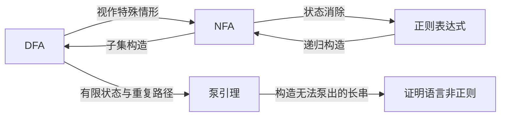

# L5 自动机构造练习与泵引理

本组笔记补充自动机转换例题和非正则性证明。[Week 4](../../理论计算机科学导引_Week4_整理笔记.md)、[Week 5](../../理论计算机科学导引_Week5_整理笔记.md)已给出 DFA/NFA、连接与星封闭性、正则表达式和状态消除的完整原理；这里集中练习新材料中的图与证明。

来源：`L5_0_1793243778225.pdf`，共 7 页。第 1-6 页为手写内容，第 7 页为空白。以下页码均指 PDF 阅读器从 1 开始的页序。

## 阅读顺序

| 笔记 | 对应原稿 | 复习重点 |
| --- | --- | --- |
| [ε 闭包与子集构造练习](01-subset-construction.md) | 第 1-2 页的知识点；例题为自编补充 | 初始闭包、字符后的闭包、可达子集与空集陷阱；连接与星构造回查 Week 5 |
| [正则表达式与状态消除例题](02-regular-expressions-and-elimination.md) | 第 2-5 页 | `(01∪0)*` 的 ε-NFA、模 3 计数例题、路径递推的记号纠正 |
| [泵引理与非正则性证明](03-pumping-lemma.md) | 第 6 页 | 量词顺序、鸽巢原理、任意合法拆分与反证 |

## 知识主线

“等价”表示识别的语言类别相同，不表示状态数相同，也不表示转换结果必然最简。

## 三类题的解题入口

| 题目要求 | 应采用的思路 | 关键检查 |
| --- | --- | --- |
| 把 NFA 化成 DFA | 用一个状态子集记录所有可能位置 | 初态和每次读字符之后都处理 ε 闭包 |
| 把自动机写成正则表达式 | 增加新起点、终点，再消去中间状态 | 并联取并集；经过被删状态的路径不能漏掉 |
| 证明一个语言正则 | 构造 DFA/NFA/正则表达式，或使用已证明的封闭性 | 确认识别全部且仅有目标字符串 |
| 证明一个语言不正则 | 反设正则，再用泵引理制造矛盾 | 必须覆盖任意合法拆分，不能只挑一个失败拆分 |

## 符号速查

| 符号 | 含义 |
| --- | --- |
| $`\Sigma`$ | 输入字母表 |
| $`\Sigma^*`$ | 字母表上的全部有限字符串，包括空串 |
| $`\epsilon`$ | 空串，长度为 0；不是输入字母 |
| $`\varnothing`$ | 空集合；作为语言时不含任何字符串 |
| $`\{\epsilon\}`$ | 只含空串的语言，与空语言不同 |
| $`L(M)`$、$`L(R)`$ | 自动机 M 识别的语言、正则表达式 R 描述的语言 |
| $`2^Q`$ | 状态集合 Q 的幂集，即所有状态子集组成的集合 |

原稿中的 `e` 统一写为 $`\epsilon`$。四元组省略固定的字母表，五元组将其显式列出，二者描述同一模型；表达式与表达式描述的语言分别书写。新增材料和原有 `w4.pdf`、`w5.pdf` 页码分别标注。

学完泵引理后，可继续阅读[作业 2 第 6 题的重复串语言证明](../../作业2_解答.md)，练习在删除片段后排除所有可能的重新分半方式。

[返回仓库目录](../../README.md) · [回顾 Week 5](../../理论计算机科学导引_Week5_整理笔记.md)
